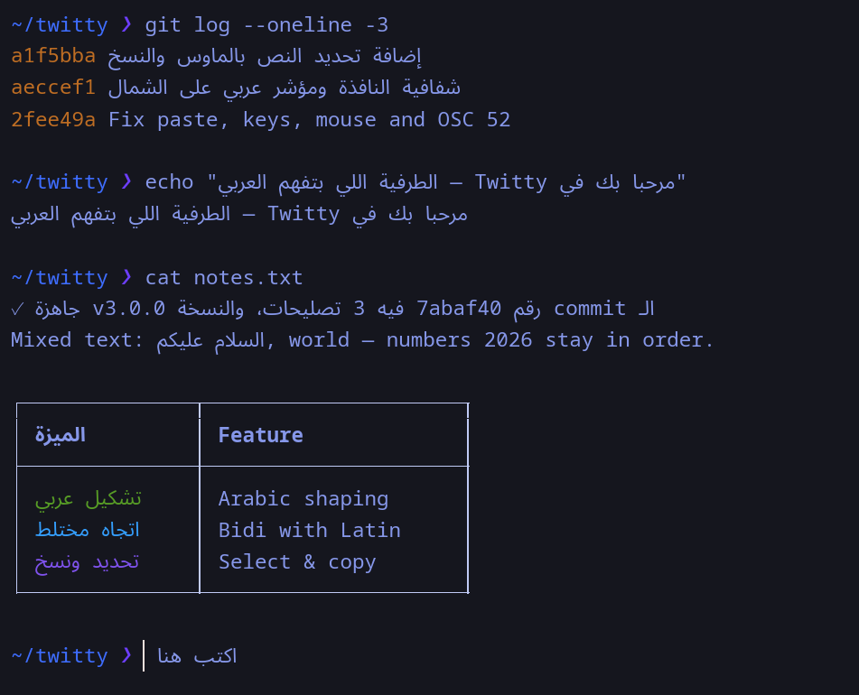

<div align="center">


# Twitty

**A native, GPU-rendered terminal that reads Arabic the way it's written.**

Arabic letters join, sentences flow right-to-left, and English words, hashes and numbers inside them stay intact, all without touching the bytes your shell and TUIs rely on.

[](https://github.com/omarallsharkawy/RTL-Terminal/actions/workflows/build.yml)
&nbsp;·&nbsp; Rust · wgpu · cosmic-text · alacritty_terminal



</div>

## Features

**Arabic and mixed text**
- Contextual Arabic shaping with harakat (تشكيل) kept on their letters.
- Right-to-left flow inside a line, while prompts and terminal layout stay left-to-right, so nothing flips.
- English words, commit hashes and numbers inside Arabic stay whole and in order (`7abaf40`, `v3.0.0`, `2026`).
- While you type Arabic, the cursor sits on the left of what you wrote, and spaces stay on that side too.

**Terminal**
- Full ANSI and 24-bit color, bold/italic/dim/inverse, underline, strikethrough.
- Pixel-exact box drawing and block elements for TUIs (htop, vim, lazygit…).
- Scrollback with mouse wheel and trackpad, bracketed paste, xterm mouse reporting.
- Complete key encoding: Alt/Meta, F1–F12, modified arrows and navigation keys, AltGr layouts.
- Window title, bell, OSC 52 copy and OSC 10/11 color queries.

**Everyday use**
- Select with the mouse (double-click for a word, triple-click for a line). Releasing the mouse copies the text.
- See-through window background.
- Cursor style: block, beam or underline. It turns hollow when the window loses focus.
- Zoom with Ctrl+wheel or Ctrl+= / Ctrl+-, saved between sessions.
- HiDPI aware. Falls back to a software GPU adapter on VMs and RDP.

## Install

### Linux

Download `twitty-<version>-linux-x86_64.tar.gz` from the [latest release](https://github.com/omarallsharkawy/RTL-Terminal/releases/latest), then:

```bash
tar -xzf twitty-*-linux-x86_64.tar.gz
install -m755 twitty ~/.local/bin/twitty
```

Works on Wayland and X11.

### Windows

Download `twitty-<version>-windows-x86_64.exe` from the [latest release](https://github.com/omarallsharkawy/RTL-Terminal/releases/latest) and run it. Each release ships a `SHA256SUMS.txt`. Builds are not code-signed yet, so SmartScreen may warn about an unknown publisher.

### From source

Requires [Rust](https://rustup.rs/) (stable).

```bash
git clone https://github.com/omarallsharkawy/RTL-Terminal.git
cd RTL-Terminal
cargo build --release
./target/release/twitty
```

## Usage

### Shortcuts

| Action | Keys |
| --- | --- |
| Copy selection | Release the mouse, or Ctrl+Shift+C |
| Paste | Ctrl+Shift+V, or middle-click |
| Select word / line | Double-click / triple-click |
| Select inside vim, Claude Code, etc. | Hold Shift while dragging |
| Zoom in / out / reset | Ctrl+= / Ctrl+- / Ctrl+0, or Ctrl+wheel |
| Background transparency | Ctrl+Shift+wheel |

### Configuration

The config file is `~/.config/twitty/config.json` (`%APPDATA%\twitty\config.json` on Windows). Every key is optional:

```json
{
  "font_size": 14.5,
  "background_opacity": 0.78,
  "cursor_style": "beam"
}
```

| Key | Values |
| --- | --- |
| `font_size` | 8 to 48 |
| `background_opacity` | 0.2 (very see-through) to 1.0 (solid) |
| `cursor_style` | `block`, `beam` or `underline`. Programs that set their own cursor shape (vim insert mode, for example) still win. |

Zoom and transparency changes are written back to this file when Twitty closes. Keys Twitty doesn't recognize are left untouched.

### Shell

On Linux and macOS Twitty starts `$SHELL` as a login shell. On Windows it picks PowerShell 7 (`pwsh.exe`), then Windows PowerShell, then `%COMSPEC%`. Set `TWITTY_SHELL` to override, arguments included:

```bash
TWITTY_SHELL="bash --norc" twitty
```

## How the Arabic rendering works

A terminal grid is a row of fixed-width cells, and Arabic is not. Twitty keeps the grid as the source of truth and only changes how each row is drawn:

1. **The terminal state is untouched.** `alacritty_terminal` parses the PTY stream into cells exactly as any terminal would. Twitty never rewrites what the shell sent.
2. **Rows are split into segments.** A segment breaks at background color changes, box-drawing characters and wide gaps, so TUI columns and borders never bleed into each other.
3. **Each segment is shaped with full bidi.** `cosmic-text` joins the Arabic letters and orders the runs. A leading LRM keeps the paragraph left-to-right so prompts never jump to the other side. Latin words and numbers inside Arabic are wrapped in LRI/PDI isolates so they can't be torn apart.
4. **Glyphs map back to cells.** Every glyph remembers which cell it came from. The cursor, cell backgrounds and selection therefore line up with what you see, not just with grid columns.
5. **Everything else stays on the grid.** Latin-only text, symbols and emoji are pinned to their cell, and box drawing is rendered as geometry.

## Development

```bash
cargo test                                  # all tests, no GPU needed
cargo clippy --all-targets -- -D warnings
cargo fmt
```

| Path | What it does |
| --- | --- |
| `src/app.rs` | Window events, mouse, selection, clipboard, scrolling |
| `src/renderer.rs` | Row segmentation, bidi shaping, cursor placement, GPU drawing |
| `src/terminal.rs` | `alacritty_terminal` wrapper: snapshots, scrollback, selection |
| `src/input.rs` | Keyboard, paste and mouse encoding |
| `src/pty.rs` | Shell discovery and PTY I/O |
| `src/quad.rs` | Backgrounds, cursor, box-drawing geometry |
| `src/color.rs` | Palette (Tokyo Night) and color resolution |
| `src/config.rs` | `config.json` loading and saving |

CI runs fmt, clippy and tests, builds Windows and Linux binaries, and audits dependencies. Pushing a `v*` tag publishes a release whose notes come from the matching section of [`CHANGELOG.md`](CHANGELOG.md).

## License

See [`LICENSE.txt`](LICENSE.txt).
