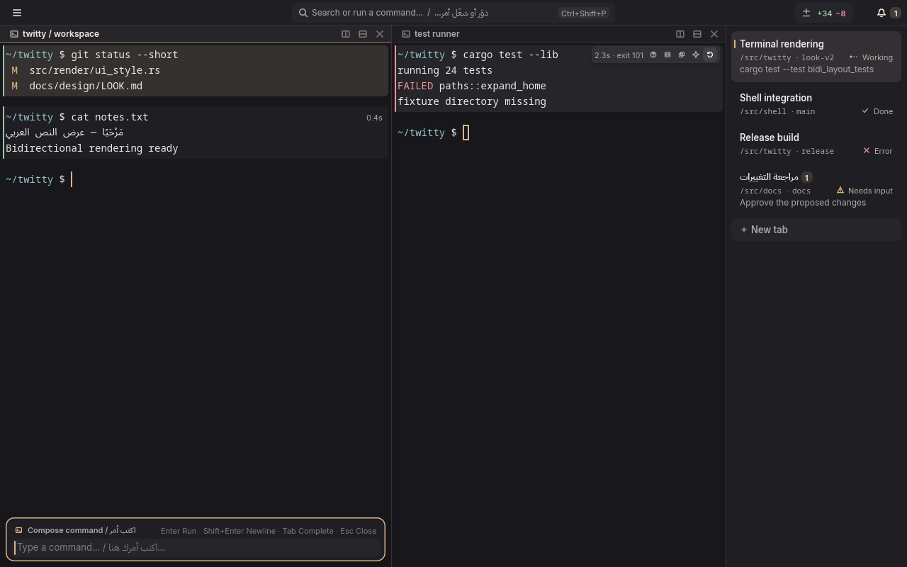
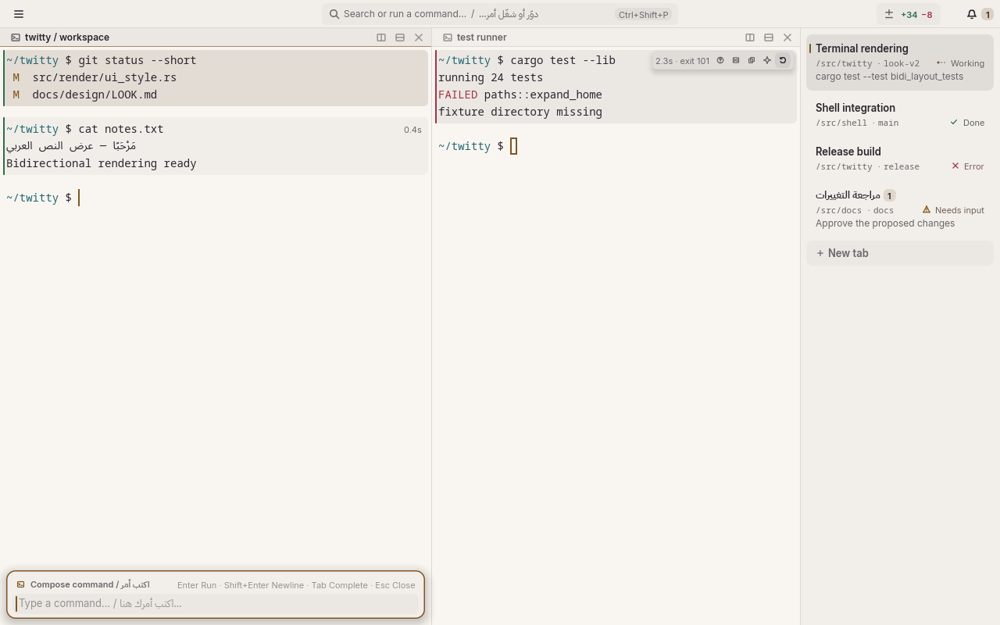
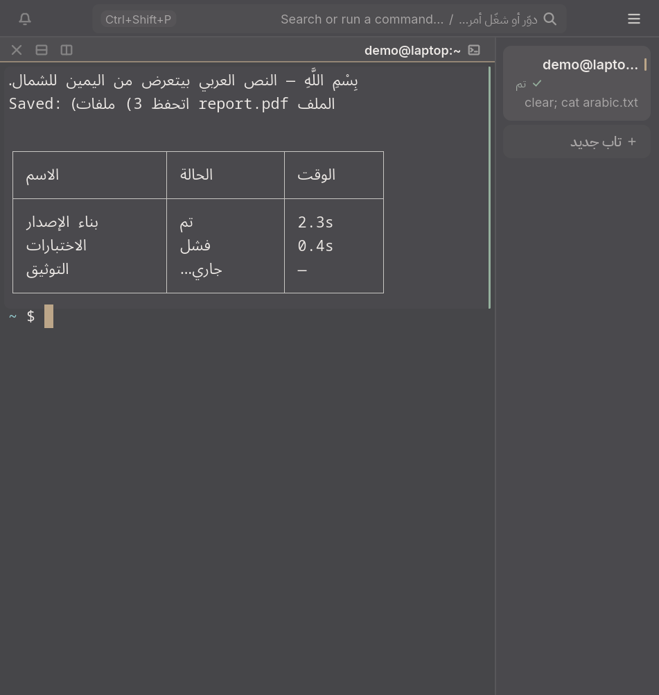
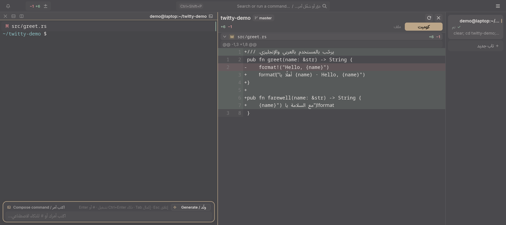

<div align="center">


# Twitty

**A native, GPU-rendered terminal workspace built for Arabic and bidirectional text.**

Twitty is a Rust (`wgpu` + `cosmic-text` + `alacritty_terminal`) terminal emulator where Arabic letters join with harakat, right-to-left phrases flow naturally, and embedded English words, hashes, and numbers stay intact—all while keeping the terminal grid strictly logical so shells and TUIs never see altered bytes. Alongside fast bidirectional rendering, it ships with a workspace sidebar, OSC 133 command blocks, an Arabic-aware multi-line command composer, read-only local-agent AI, a side-by-side Git review panel, persistent SSH tabs, in-app bilingual settings, and a scriptable control socket.

[](https://github.com/omarallsharkawy/RTL-Terminal/actions/workflows/build.yml)
&nbsp;·&nbsp; Rust · wgpu · cosmic-text · alacritty_terminal · AGPL-3.0-or-later

</div>

## Screenshots

> Release screenshots live in [`docs/screenshots/`](docs/screenshots/README.md).

| Twitty Dark | Twitty Light |
| --- | --- |
|  |  |

| Arabic UI & mixed RTL text | Git review panel & command composer |
| --- | --- |
|  |  |

## Features

**Arabic and bidirectional text**
- Contextual Arabic shaping with harakat (تشكيل) kept on their letters and embedded Noto Naskh Arabic fallback when no system Arabic font is installed.
- Right-to-left flow for Arabic phrases (including after a shell prompt) while prompts and terminal layout remain left-to-right.
- English words, commit hashes, and numbers inside Arabic stay whole and in order (`7abaf40`, `v3.0.0`, `2026`); selection, highlights, underlines, and cursor placement follow the drawn glyphs.
- Input methods (`fcitx5`, `ibus`, Windows IME) with inline composition at the cursor and caret-following candidate popups.

**Workspaces, sidebar, and productivity**
- Vertical workspace sidebar (`right`, `left`, or `hidden`) showing each tab's title, working directory, Git branch, listening TCP ports, running/exit/agent state, unread badge, and latest message, with drag-to-reorder and a rounded pill tab strip when hidden.
- Tabs and split panes with pane zoom (`Ctrl+Shift+Z`), outline flash (`Ctrl+Shift+H`), tab rename (`Ctrl+Shift+N`), close sibling panes (`Ctrl+Shift+K`), tab reordering, reopen closed tab (`Ctrl+Shift+Alt+T`), and session restore.
- Bilingual English/Arabic command palette (`Ctrl+Shift+P`), project switcher (`Ctrl+Shift+L`), named split layouts, opt-in broadcast input, custom workflows (global and per-project `.twitty/commands.json` with SHA-256 trust), scrollback search (`Ctrl+Shift+F`), and Arabic-aware search across all terminals (`Ctrl+Shift+G`).
- Desktop notifications (`notify-send`), notification history (`Ctrl+Shift+I`), and jumping to unread panes (`Ctrl+Shift+J` / `Ctrl+Shift+U`).

**Command blocks and multi-line composer**
- Automatic bash, zsh, and fish shell integration emitting OSC 133 command marks and OSC 7 working directories.
- Rounded command block cards on the main screen with status strips, keyboard navigation (`Ctrl+Shift+Up`/`Down`), output copy (`Ctrl+Shift+Y`), and a hover toolbar (copy command, copy output, ask agent, rerun without newline, duration and exit status).
- Multi-line Arabic-aware command composer (`Ctrl+Shift+Space`) with history, spec-driven and dynamic completions, inline ghost suggestions, shell syntax highlighting, and pre-run lint marks.

**Built-in AI, code review, and coding agents**
- Read-only built-in AI backed by locally installed coding-agent CLIs (`claude`, `codex`, `gemini`, `opencode`)—no API keys stored by Twitty—for natural-language command generation in the composer and **Explain error** / **Suggest a fix** on failed blocks, with one-time consent and review-before-run.
- Interactive **Ask an agent** (`Ctrl+Shift+A`) and zero-config Claude Code hooks (`claude_hooks`) reporting live per-pane agent status and notifications without editing `~/.claude/settings.json`.
- Side-by-side Git code review panel (`Ctrl+Shift+R`) for uncommitted changes and untracked files, with Arabic-shaped diffs and line comments pasted straight into the tab's coding agent.

**Look, settings, SSH, and control socket**
- **Twitty Dark** (default) and **Twitty Light** themes plus eight additional built-in themes and custom `colors` overrides, theme-derived chrome surfaces, unified window opacity, bundled Inter and IBM Plex Sans Arabic UI fonts, and an in-app bilingual Settings screen (`Ctrl+,`).
- Persistent Linux SSH tabs (`twitty ssh`) backed by `twitty-remote` with automatic upload, reconnect, 256 KiB output replay, and session restore.
- Private Unix control socket (`twitty ctl`) with cmux v2 JSON-RPC and minimal v1 hook compatibility.
- Full ANSI and 24-bit color, pixel-exact box drawing, kitty keyboard protocol, clickable OSC 8 / plain links with target preview and safe `file://` handling, Trojan Source bidi protection, HiDPI scaling, and software GPU fallback.

## Install

### Linux

Works on Wayland and X11. Every release ships a `SHA256SUMS.txt`.

**Arch Linux (AUR):**

```bash
yay -S twitty-bin    # prebuilt release binaries
# or build from source:
yay -S twitty-git
```

**AppImage (portable, no install required):**

Download `twitty-<version>-linux-x86_64.AppImage` from the [latest release](https://github.com/omarallsharkawy/RTL-Terminal/releases/latest), make it executable, and run it:

```bash
chmod +x twitty-*-linux-x86_64.AppImage
./twitty-*-linux-x86_64.AppImage
```

Host Vulkan/OpenGL drivers are used directly (no GPU drivers are bundled inside the AppImage), and `twitty-remote` is bundled alongside `twitty` for persistent SSH tabs.

**Release tarball (with desktop entry and icons):**

Download `twitty-<version>-linux-x86_64.tar.gz` from the [latest release](https://github.com/omarallsharkawy/RTL-Terminal/releases/latest), then:

```bash
tar -xzf twitty-*-linux-x86_64.tar.gz
cd twitty-*-linux-x86_64
./install.sh                  # installs to ~/.local (binaries, .desktop, icons, metainfo)
# or system-wide:
sudo ./install.sh --system    # installs to /usr/local
```

### Windows

Download `twitty-<version>-windows-x86_64.zip` from the [latest release](https://github.com/omarallsharkawy/RTL-Terminal/releases/latest), extract it, and run `twitty.exe`. Every release ships a `SHA256SUMS.txt`. Builds are not code-signed yet, so SmartScreen may warn about an unknown publisher.

### From source

Requires [Rust](https://rustup.rs/) (stable, MSRV 1.90).

```bash
git clone https://github.com/omarallsharkawy/RTL-Terminal.git
cd RTL-Terminal
cargo build --release
./target/release/twitty
```

## Usage

### Shortcuts

| Action | Keys |
| --- | --- |
| Command palette | Ctrl+Shift+P |
| Command composer (toggle / open) | Ctrl+Shift+Space |
| Settings (Appearance, Behaviour, Keys, About) | Ctrl+, |
| Copy selection | Release the mouse, or Ctrl+Shift+C |
| Paste | Ctrl+Shift+V, or middle-click |
| Search scrollback | Ctrl+Shift+F, then type. Enter = older match, Shift+Enter = newer, Esc closes |
| Search all terminals (every tab and pane, screen and scrollback) | Ctrl+Shift+G, then type 2+ characters (Arabic without tashkeel or with any alef form matches). Enter jumps to the line and highlights it; Esc closes |
| Select word / line | Double-click / triple-click |
| Select inside vim, Claude Code, etc. | Hold Shift while dragging |
| Zoom in / out / reset | Ctrl+= / Ctrl+- / Ctrl+0, or Ctrl+wheel |
| Background transparency | Ctrl+Shift+wheel |
| Open a link (OSC 8 or plain URL) | Ctrl+Click |
| New tab / close pane (last pane closes the tab) | Ctrl+Shift+T / Ctrl+Shift+W |
| Reopen last closed tab (restores directory and title) | Ctrl+Shift+Alt+T |
| Switch to tab 1–9 | Ctrl+Shift+1 … Ctrl+Shift+9 |
| Rename tab (empty clears custom title) | Ctrl+Shift+N |
| Next / previous tab | Ctrl+Tab / Ctrl+Shift+Tab, or Ctrl+PageDown / Ctrl+PageUp; or click the tab |
| Move tab left / right | Ctrl+Shift+PageUp / Ctrl+Shift+PageDown |
| Open project switcher (Enter: tab or switch, Alt+Enter: split) | Ctrl+Shift+L |
| Split right / split down | Ctrl+Shift+E / Ctrl+Shift+O |
| Toggle pane zoom (maximize focused pane within its tab) | Ctrl+Shift+Z |
| Close other panes in the tab (confirms if any runs a program) | Ctrl+Shift+K |
| Flash focused pane outline | Ctrl+Shift+H |
| Focus the pane to the left / right / above / below | Alt+Arrow keys, or click the pane |
| Resize a split | Drag the divider |
| Toggle workspace sidebar | Ctrl+Shift+B |
| Jump to newest / next unread notification | Ctrl+Shift+J / Ctrl+Shift+U |
| Open notification list | Ctrl+Shift+I |
| Previous / next command block | Ctrl+Shift+Up / Ctrl+Shift+Down |
| Copy command block output | Ctrl+Shift+Y |
| Ask a coding agent about the selected block or screen | Ctrl+Shift+A |
| Review changes (the focused repository's uncommitted diff, beside the panes) | Ctrl+Shift+R |

With a single pane, Alt+Arrow goes to the program (fish, readline word jumps); with a single tab, so do Ctrl+Tab and Ctrl+PageUp/PageDown.

The top bar opens the sidebar, command palette and notification history. It shows the focused
local Git worktree’s changed line counts and opens the code review panel on click. Pane
headers show the program or agent and offer split and close buttons. Tabs move to the sidebar
when it is visible.

### Configuration

The config file is `~/.config/twitty/config.json` (`%APPDATA%\twitty\config.json` on Windows). Every key is optional:

```json
{
  "font_size": 14.5,
  "background_opacity": 0.78,
  "cursor_style": "beam"
}
```

| Key | Values |
| --- | --- |
| `font_size` | 8 to 48 |
| `font_family` | Font for the terminal grid, e.g. `JetBrains Mono`. Unset, or not installed: the system monospace font. Arabic uses an embedded Noto Naskh Arabic when no system font covers it. |
| `ui_font_family` | Proportional chrome font. Defaults to bundled Inter for Latin and IBM Plex Sans Arabic for Arabic. |
| `ui_accent` | Chrome accent in `#rgb` or `#rrggbb`. Defaults to the theme cursor color. |
| `top_bar`, `pane_headers` | Both default to `true`. Set either to `false` to hide it. |
| `reduce_motion` | Defaults to `false`. Set to `true` for instant chrome transitions and a steady working indicator. |
| `block_cards` | `true` (default) renders OSC 133 command blocks on the main screen as rounded cards with a status strip and hover/selected toolbar (copy command, copy output, ask agent, rerun without newline). Set to `false` for thin gutter markers. |
| `background_opacity` | 0.2 (very see-through) to 1.0 (solid) |
| `cursor_style` | `block`, `beam` or `underline`. Programs that set their own cursor shape (vim insert mode, for example) still win. |
| `cursor_blink` | `true` (default) blinks the cursor, `false` keeps it solid. Programs that ask for a blinking or steady cursor (`CSI n SP q`) override this. The cursor stays solid while you type and while the window is unfocused. |
| `sidebar` | Where the workspace sidebar sits: `"right"` (default), `"left"`, or `"hidden"`. |
| `sidebar_width` | Maximum sidebar width in logical pixels (default `180`, clamped to `140`–`480`; also capped at 25% of the window width, down to `140`). |
| `desktop_notifications` | `true` (default) sends desktop notifications via `notify-send` when an unfocused pane requests attention. |
| `composer` | Multi-line command composer mode: `"off"`, `"on-demand"` (default, open with `Ctrl+Shift+Space`), or `"always"` (shown at OSC 133 shell prompts). |
| `shell_integration` | `true` (default) loads Twitty's automatic bash/zsh/fish integration for OSC 133 command blocks and OSC 7 working directories. |
| `restore_session` | `true` (default) restores tabs, splits, directories, titles, and SSH sessions saved on normal window close. |
| `agent_command` | Command run by "Ask an agent" (`Ctrl+Shift+A`), e.g. `"claude"` or `"codex"`. Unset auto-detects the first installed agent (`claude`, `codex`, `gemini`, `opencode`, `grok`). |
| `ai` | `true` (default) enables built-in read-only AI helpers (composer command generation, failed-block explain/fix). |
| `ai_agent` | Optional coding-agent CLI override for built-in AI (`claude`, `codex`, `gemini`, `opencode`). Unset falls back to `agent_command`, then auto-detects on `PATH`. |
| `ai_timeout_secs` | Timeout in seconds for non-interactive built-in AI requests (default `60`, clamped `5`–`300`). |
| `project_roots` | Array of directories scanned one or two levels deep for git repositories in the project switcher (`Ctrl+Shift+L`). Defaults to `["~/Projects", "~/src", "~/code"]` (only existing directories are scanned). |
| `commands` | Array of custom workflow commands listed in the command palette (always trusted). See [Custom commands (workflows)](#custom-commands-workflows). |
| `control_socket` | `true` (default) listens on a private Unix socket (`0600` in a `0700` dir) for `twitty ctl` and agent tools. |
| `cmux_compat` | `true` (default) exposes cmux-compatible environment variables (`CMUX_SOCKET_PATH`, `CMUX_WORKSPACE_ID`, `CMUX_SURFACE_ID`) when `control_socket` is enabled. |
| `claude_hooks` | `true` (default) puts Twitty's `claude` wrapper first on `PATH` inside Twitty shells so Claude Code reports per-pane status and notifications over the socket without editing your Claude settings files. |
| `theme`, `colors` | Built-in theme name and per-color overrides. See [Themes](#themes). |

Zoom and transparency changes are written back to this file when Twitty closes. Keys Twitty doesn't recognize are left untouched.

#### Themes

Set `theme` to one of the built-in names below. Names are case-insensitive, and spaces or underscores work in place of dashes. The default is `twitty-dark`.

`twitty-dark`, `twitty-light`, `tokyo-night`, `catppuccin-mocha`, `gruvbox-dark`, `dracula`, `nord`, `one-dark`, `solarized-dark`, `github-light`

An unknown name prints a warning and falls back to `twitty-dark`.

`colors` overrides individual parts of the theme. Every field is optional, and values are `#rgb` or `#rrggbb`. `ansi` takes up to 16 colors in palette order (black, red, green, yellow, blue, magenta, cyan, white, then the bright versions). A shorter list changes only the indices it covers. Invalid values are skipped with a warning.

```json
{
  "theme": "dracula",
  "colors": {
    "background": "#000000",
    "cursor": "#ff79c6",
    "ansi": ["#21222c", "#ff5555"]
  }
}
```

### Session restore

Closing the window saves the tabs, split sizes, pane directories and titles, focus, and sidebar
visibility. Twitty starts fresh local shells and reattaches to saved SSH sessions on the next
launch. A missing local directory uses the shell's default directory. The session file contains
no scrollback, commands, environment variables, or input. Exiting or closing the last pane
clears the saved session.

Set `"restore_session": false` in `config.json` to start with a fresh window each time. Window
close still saves the layout. The file is `$XDG_STATE_HOME/twitty/session.json`, with
`~/.local/state/twitty/session.json` as the Unix fallback, or
`%LOCALAPPDATA%\twitty\session.json` on Windows. Twitty restores up to 32 tabs and 64 panes.

### Projects, named layouts, tab history, and broadcast input

All workspace productivity commands are available in the command palette (`Ctrl+Shift+P`) with English and Arabic names:

- **Project switcher** (`Ctrl+Shift+L`, *Open project / افتح مشروع*): Lists recent Twitty pane directories (persisted in a bounded MRU file `recent_projects.json` next to `session.json`, mode `0600`) together with git repositories discovered one or two levels under `project_roots` (default `["~/Projects", "~/src", "~/code"]`), scanned off the UI thread with symlink-loop protection and showing each repository's current branch when known. Press **Enter** to switch to an existing tab already in that directory or open a new tab; press **Alt+Enter** to open a split there.
- **Named layouts** (*Save layout… / احفظ التخطيط…*, *Open layout… / افتح تخطيط…*, *Delete layout… / احذف تخطيط…*): Saves the active tab's split tree, ratios, pane working directories, and titles under a name in `$XDG_STATE_HOME/twitty/layouts.json` (versioned, bounded, mode `0600`), recreates it in a new tab on demand, or deletes it.
- **Tab reordering and reopen** (*Move tab left / حرّك التاب شمال* `Ctrl+Shift+PageUp`, *Move tab right / حرّك التاب يمين* `Ctrl+Shift+PageDown`, *Reopen closed tab / رجّع آخر تاب اتقفل* `Ctrl+Shift+Alt+T`): Reorder the active tab with the keyboard and restore the working directory and title of recently closed tabs from a bounded stack.
- **Broadcast input** (*Type in all panes of this tab / اكتب في كل اللوحات*): Off by default. When toggled on for the active tab, keystrokes, IME input, and pastes go to every pane in that tab, and every pane shows a clear header badge and coloured outline. Toggle the command again or press **Esc** twice (`Esc-Esc`) to turn it off.

### Persistent SSH tabs

Run `twitty ssh user@host --name work` on Linux. Use an SSH config alias in place of
`user@host` if you prefer. From a Twitty shell with `TWITTY_SOCKET` set, the command adds a
tab to that window. Otherwise it opens a new window. Omitting `--name` generates a session
name. The control socket also accepts `tab.new-ssh` with `destination` and optional `name`.

Keep `twitty-remote` next to `twitty`. Twitty checks and uploads it over SSH to a compatible
Linux host with the same CPU architecture. Closing the tab or losing the SSH connection
leaves the remote shell running. Twitty replays up to 256 KiB on reattach and offers Enter
to retry after five failed reconnect attempts. In an SSH login on the remote host, run
`~/.cache/twitty/bin/twitty-remote-<version> list` or use `kill work` to end that session.

### Custom commands (workflows)

You can add your own commands to the command palette (`Ctrl+Shift+P`) with optional Arabic titles (`name_ar`), either globally in `config.json` under `"commands"` or per repository in `.twitty/commands.json`.

Twitty walks up from the focused pane's working directory to the nearest `.twitty/commands.json` (stopping at `$HOME` or the filesystem root, at most 32 levels). Project command files are untrusted until you confirm them in the palette; trust is recorded per canonical directory and SHA-256 hash in `$XDG_STATE_HOME/twitty/trust.json` (`~/.local/state/twitty/trust.json`), so editing the file asks again.

Example `.twitty/commands.json`:

```json
{
  "commands": [
    {
      "name": "Run tests",
      "name_ar": "شغّل الاختبارات",
      "command": "cargo test",
      "mode": "run",
      "cwd": ".",
      "description": "Run the Rust test suite"
    },
    {
      "name": "Git status",
      "name_ar": "حالة جيت",
      "command": "git status -sb",
      "mode": "insert"
    }
  ]
}
```

- `mode`: `"insert"` (default) pastes the command into the focused pane without a newline so you can review it and press Enter; `"run"` opens a split (or tab) and runs it with `$SHELL -c <command>` in the entry's `cwd` (must stay inside the project root) or the pane's working directory.
- `twitty ctl command.list` lists built-in and custom commands (`source`, `trusted`); `twitty ctl command.run` can run trusted custom commands by name and always refuses untrusted project commands.

### Control socket & cmux compatibility

When `control_socket` is enabled (the default), Twitty listens on a same-user Unix socket (`$XDG_RUNTIME_DIR/twitty/twitty-<pid>.sock`, mode `0600` inside a `0700` directory). Alongside `twitty ctl`, the socket implements the cmux v2 JSON-RPC request/response shape (mapping a cmux **workspace** to a Twitty tab and a **pane**/**surface** to a Twitty pane):

- **System:** `system.ping`, `system.identify`, `system.capabilities`
- **Workspaces (tabs):** `workspace.list`, `workspace.current`, `workspace.create`, `workspace.new`, `workspace.select`, `workspace.close`, `workspace.rename`, `workspace.set_status`, `workspace.clear_status`, `workspace.list_status`
- **Panes & surfaces:** `pane.list`, `pane.split`, `pane.new`, `pane.create`, `pane.focus`, `pane.close`, `surface.list`, `surface.current`, `surface.split`, `surface.focus`, `surface.close`, `surface.send_text`, `surface.send_input`, `surface.send_key`, `surface.read_text`
- **Notifications & sidebar:** `notification.create`, `notification.create_for_surface`, `notification.create_for_target`, `notification.list`, `notification.clear`, `sidebar.show`, `sidebar.hide`, `sidebar.toggle`, `sidebar.status`
- **Minimal v1 text commands (hook path):** `ping`, `set_status`, `clear_status`, `list_status`, `notify`, `notify_surface`, `notify_target`

Browser, markdown, settings, and other unrecognized methods return a cmux `unknown_method` error. All existing `twitty ctl` methods (`system.ping`, `tab.list`, `tab.new`, `tab.new-ssh`, `pane.list`, `pane.focus`, `pane.split`, `pane.send-text`, `pane.read`, `notify`, `command.list`, `command.run`) continue to work unchanged (clipboard paste via `command.run` is blocked to match OSC 52 clipboard-read protection).

Environment variables set on spawned panes (inherited `TWITTY_*` and `CMUX_*` variables from parent terminals are stripped first):

| Variable | Meaning |
| --- | --- |
| `TWITTY_SOCKET` / `TWITTY_PANE_ID` | Control socket path and current pane id |
| `CMUX_SOCKET_PATH` | Control socket path (when `cmux_compat` and `control_socket` are enabled) |
| `CMUX_WORKSPACE_ID` | Stable id of the pane's tab |
| `CMUX_SURFACE_ID` | Current pane id |

### Review changes

`Ctrl+Shift+R` (or "Review changes / راجع التغييرات" in the command palette) opens a panel on the right with the uncommitted changes of the focused pane's git repository (`git diff HEAD` plus untracked files), refreshed when it opens, when a command ends in that pane, and with its ↻ button or `r`. Click it (or open it) to give it the keyboard; Esc gives the keyboard back.

- Up/Down (or j/k), PageUp/PageDown, Home/End scroll; `n` / `p` jump to the next / previous file; Enter or a click on a file folds it.
- Click a line number (or press `c`, or Enter on a line) to comment on it. Enter types `path:line: comment (line: "…")` into the coding agent's input in this tab (the focused pane if it runs one, else the first pane running `claude`, `codex`, `gemini`, `opencode`, `grok` or your `agent_command`) as a paste, without a newline: nothing is sent until you press Enter there. With no agent pane, a second Enter starts one with the comment.
- **Commit** types `git commit` into the focused pane, without running it.
- Arabic in diff lines is shown as the terminal shows it. Bounded: 2 MiB of diff, 200 files, 20 000 lines; binary and very large files are one line each.

### Claude Code integration

When `claude_hooks` and `control_socket` are enabled, Twitty writes a `claude` wrapper script into a private `0700` directory and puts it first on `PATH` inside Twitty shells.

- Outside Twitty, when `claude_hooks` is `false`, when `TWITTY_CLAUDE_HOOKS_DISABLED=1` or `CMUX_CLAUDE_HOOKS_DISABLED=1` is set, or when the socket does not reply within ~0.75 s, the wrapper executes the real `claude` unchanged.
- Inside a live Twitty shell, it passes `--settings` in memory so Claude Code's lifecycle hooks call `twitty claude-hook <event>` (reading bounded JSON on stdin). Your `~/.claude/settings.json` is never modified.
- Twitty tracks per-pane agent status (`working`, `needs input`, `done`) in the sidebar; `needs input` and `done` events also go through Twitty's notification history and desktop notification path, with Arabic and mixed text cleaned and shaped normally.

### Shell

On Linux and macOS Twitty starts `$SHELL` (falling back to `/bin/bash`; remote SSH helper sessions start `$SHELL -l`). On Windows it picks PowerShell 7 (`pwsh.exe`), then Windows PowerShell, then `%COMSPEC%`. Set `TWITTY_SHELL` to override, arguments included:

```bash
TWITTY_SHELL="bash --norc" twitty
```

## How the Arabic rendering works

A terminal grid is a row of fixed-width cells, and Arabic is not. Twitty keeps the grid as the source of truth and only changes how each row is drawn:

1. **The terminal state is untouched.** `alacritty_terminal` parses the PTY stream into cells exactly as any terminal would. Twitty never rewrites what the shell sent.
2. **Rows are split into segments.** A segment breaks at background color changes, box-drawing characters and wide gaps, so TUI columns and borders never bleed into each other.
3. **Each segment is shaped with full bidi.** `cosmic-text` joins the Arabic letters and orders the runs. A leading LRM keeps the paragraph left-to-right so prompts never jump to the other side. Latin words and numbers inside Arabic are wrapped in LRI/PDI isolates so they can't be torn apart.
4. **Glyphs map back to cells.** Every glyph remembers which cell it came from. The cursor, cell backgrounds and selection therefore line up with what you see, not just with grid columns.
5. **Everything else stays on the grid.** Latin-only text, symbols and emoji are pinned to their cell, and box drawing is rendered as geometry.

## Development

```bash
cargo test                                  # all tests, no GPU needed
cargo clippy --all-targets -- -D warnings
cargo fmt
```

| Path | What it does |
| --- | --- |
| `src/app/` | The winit app: routes window events to keyboard, mouse, selection, pane, settings, review, SSH, and window modules; `window.rs` holds every renderer call |
| `src/session/` | Panes (terminal + PTY), the workspace of tabs and splits, shell integration setup, session restore |
| `src/ui/` | Window-free UI logic: chrome geometry, hit testing, search, command palette, Settings panel, notifications, selection, clipboard |
| `src/render/` | Rendering. `text/`: fonts, bidi and row shaping; `row/`: shaped-row cache, hit testing, caret placement; `scene/`: CPU frame layout (block cards, cell quads, chrome shapes, overlays); `gpu/`: wgpu quad, shape, and glyphon text pipelines |
| `src/blocks/`, `src/composer/`, `src/ai/` | OSC 133 command blocks and cards; multi-line Arabic-aware command composer with completions, highlighting, and linting; read-only local-agent AI |
| `src/sidebar/`, `src/review/`, `src/projects/`, `src/layouts/`, `src/workflows/` | Workspace sidebar model, Git review panel, project switcher, named layouts, custom workflow commands |
| `src/control/`, `src/remote/` | Control socket (`twitty ctl` + cmux compatibility), Claude Code hooks, persistent SSH tabs and `twitty-remote` daemon |
| `src/terminal.rs` | `alacritty_terminal` wrapper: snapshots, scrollback, selection, search |
| `src/input/` | Keyboard (legacy + kitty protocol), paste and mouse encoding; key routing; pointer state machines |
| `src/layout.rs` | Split tree, pane and divider geometry, sidebar and tab strip layout |
| `src/pty.rs` | Shell discovery and PTY I/O |
| `src/color.rs` | Built-in themes (`twitty-dark`, `twitty-light`, and 8 others) and color resolution |
| `src/config.rs` | `config.json` loading, clamping, warnings, and atomic saving |

See [ARCHITECTURE.md](ARCHITECTURE.md) for how the pieces fit, [docs/adr/](docs/adr/) for design decisions, and [CONTRIBUTING.md](CONTRIBUTING.md) before opening a pull request.

CI runs fmt, clippy and tests on Linux and Windows, checks the minimum Rust version (1.90), checks dependency licenses, builds Windows and Linux binaries, and audits dependencies. Pushing a `v*` tag publishes a release whose notes come from the matching section of [`CHANGELOG.md`](CHANGELOG.md).

## License

Twitty is licensed under the [GNU Affero General Public License v3.0 or later](LICENSE) (AGPL-3.0-or-later). Releases up to 3.0.0 were licensed under MIT OR Apache-2.0; the change makes room for code taken from other open-source terminals.

Twitty includes or adapts code from these projects, under their licenses (copies in [`licenses/`](licenses/)):

- [cmux-gtk](https://github.com/douglas/cmux-gtk), AGPL-3.0-or-later ([`licenses/cmux-gtk.txt`](licenses/cmux-gtk.txt)), itself a Linux port of
- [cmux](https://github.com/manaflow-ai/cmux), GPL-3.0-or-later ([`licenses/cmux.txt`](licenses/cmux.txt)).
- [Warp](https://github.com/warpdotdev/warp), AGPL-3.0 with its UI framework under MIT ([`licenses/warp-AGPL.txt`](licenses/warp-AGPL.txt), [`licenses/warp-MIT.txt`](licenses/warp-MIT.txt)).

[`licenses/NOTICE.md`](licenses/NOTICE.md) lists which Twitty files contain code from each project.

Unless you explicitly state otherwise, any contribution you intentionally submit for inclusion in Twitty is licensed under AGPL-3.0-or-later.

The licenses cover the code. The Twitty name and logo are not licensed for use by forks or derivative products.
